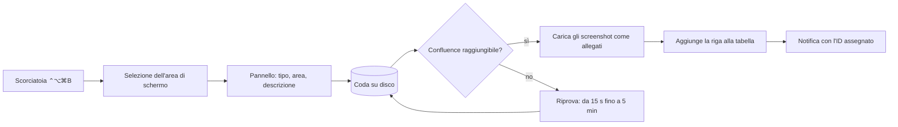

<a id="readme-top"></a>

<div align="center">
  

  <h1>Snitch</h1>

  <p><a href="README.md">English</a> · <strong>Italiano</strong></p>

  <p>
    <strong>Dal bug sullo schermo alla riga su Confluence, con una scorciatoia.</strong><br>
    Un'app per la barra dei menu di macOS che cattura uno screenshot, chiede due parole di descrizione
    e aggiunge la segnalazione alla tabella dei bug della tua pagina Confluence.
  </p>

  <p>
    
    
    
    
    
  </p>

  <p>
    <a href="https://github.com/p1e7r0/snitch/releases/latest"><strong>Scarica l'app</strong></a>
    ·
    <a href="#per-iniziare">Per iniziare</a>
    ·
    <a href="#uso">Uso</a>
    ·
    <a href="#la-pagina-su-confluence">La pagina su Confluence</a>
    ·
    <a href="#risoluzione-dei-problemi">Risoluzione dei problemi</a>
  </p>
</div>

<details>
  <summary>Indice</summary>
  <ol>
    <li><a href="#il-progetto">Il progetto</a></li>
    <li><a href="#come-funziona">Come funziona</a></li>
    <li>
      <a href="#per-iniziare">Per iniziare</a>
      <ul>
        <li><a href="#prerequisiti">Prerequisiti</a></li>
        <li><a href="#installazione">Installazione</a></li>
        <li><a href="#configurazione">Configurazione</a></li>
      </ul>
    </li>
    <li><a href="#uso">Uso</a></li>
    <li><a href="#la-pagina-su-confluence">La pagina su Confluence</a></li>
    <li><a href="#coda-e-tentativi">Coda e tentativi</a></li>
    <li><a href="#dati-e-sicurezza">Dati e sicurezza</a></li>
    <li><a href="#sviluppo">Sviluppo</a></li>
    <li><a href="#disinstallazione">Disinstallazione</a></li>
    <li><a href="#risoluzione-dei-problemi">Risoluzione dei problemi</a></li>
    <li><a href="#licenza">Licenza</a></li>
  </ol>
</details>

## Il progetto

Segnalare un bug mentre si sta facendo altro costa troppo: fare lo screenshot, aprire Confluence, entrare in modifica, caricare l'immagine, trovare l'ID successivo, salvare. Snitch riduce tutto a una scorciatoia e a una riga di testo, e si occupa del resto in sottofondo.

- **Una scorciatoia globale** (`⌃⌥⌘B`, modificabile) avvia la selezione dell'area di schermo da catturare.
- **Un pannello minimale** chiede tipo (Bug o Feature), area e descrizione; `Invio` invia, `Esc` annulla.
- **Più screenshot per segnalazione**: premi di nuovo la scorciatoia mentre il pannello è aperto.
- **Più pagine di destinazione**, anche su Confluence diversi, ognuna con il proprio token.
- **ID progressivo automatico** e stato iniziale «Aperto» in ogni nuova riga.
- **Coda su disco**: se la rete o la VPN mancano, la segnalazione aspetta e parte da sola appena possibile.
- **Nessuna riga doppia**, anche se l'invio viene interrotto a metà e ripetuto.
- **Pagina pronta dal modello**: Snitch può creare per te la pagina con la tabella vuota.
- **In inglese e in italiano**: l'app segue la lingua di macOS, o quella che scegli nelle impostazioni, e scrive su ogni pagina nella lingua della sua tabella.
- **Nessuna dipendenza esterna**: solo Swift, AppKit e SwiftUI.

<p align="right">(<a href="#readme-top">torna su</a>)</p>

## Come funziona



Il codice è diviso in due moduli:

| Modulo | Contenuto |
| --- | --- |
| `SnitchCore` | Logica senza interfaccia: client REST di Confluence, lettura e modifica della tabella nel formato di archiviazione della pagina, coda su disco, invio con gestione dei conflitti. È la parte coperta dai test. |
| `Snitch` | L'app: icona nella barra dei menu, scorciatoia globale, cattura dello schermo, pannello di segnalazione, impostazioni, Portachiavi, notifiche. |

<p align="right">(<a href="#readme-top">torna su</a>)</p>

## Per iniziare

### Prerequisiti

- macOS 15 o successivo.
- Per l'app già compilata: un Mac con Apple Silicon.
- Per compilare dai sorgenti: toolchain Swift 6.2 o successiva (inclusa in Xcode 26).
- Un Confluence raggiungibile in HTTPS e un **personal access token**: Snitch si autentica con l'intestazione `Authorization: Bearer`, cioè con i token personali di Confluence Data Center.
- Il permesso di modificare la pagina che conterrà le segnalazioni.

### Installazione

#### Scarica l'app

1. Scarica `Snitch-1.0.dmg` dalla [pagina delle release](https://github.com/p1e7r0/snitch/releases/latest).
2. Apri l'immagine disco e trascina Snitch nella cartella Applicazioni.
3. Avvia Snitch. Al primo avvio macOS lo blocca, perché l'app non è notarizzata da Apple: apri Impostazioni di Sistema → Privacy e sicurezza, scorri fino all'avviso su Snitch e scegli **Apri comunque**.

> [!NOTE]
> L'app distribuita ha una firma locale, senza identità di sviluppatore. Dopo un aggiornamento macOS chiede quindi di nuovo il permesso di registrazione dello schermo.

#### Compila dai sorgenti

```sh
git clone https://github.com/p1e7r0/snitch.git
cd snitch
./Scripts/build-app.sh --install
```

Lo script compila in modalità release, crea `build/Snitch.app`, lo firma e, con `--install`, lo copia in `/Applications` e lo avvia. Senza `--install` si ferma al bundle in `build/`.

> [!NOTE]
> Lo script firma l'app con una firma locale, senza identità di sviluppatore: l'app funziona, ma macOS chiederà di nuovo il permesso di registrazione dello schermo a ogni ricompilazione. Per usare una tua identità di firma, e conservare i permessi tra una compilazione e l'altra, indicala in `SNITCH_SIGNING_IDENTITY`.

Per ottenere un'immagine disco da distribuire:

```sh
./Scripts/make-dmg.sh
```

Il risultato è `build/Snitch-<versione>.dmg`, con l'app e il collegamento ad Applicazioni.

### Configurazione

Al primo avvio, finché manca una pagina con il relativo token, Snitch apre da solo la finestra delle impostazioni.

1. **Aggiungi una pagina.** Incolla l'indirizzo della pagina così come compare nel browser. Sono riconosciuti due formati, solo in `https`:
   ```text
   https://confluence.example.com/pages/viewpage.action?pageId=123456
   https://confluence.example.com/spaces/CHIAVE/pages/123456/Titolo
   ```
   In alternativa usa **Nuova pagina da modello**: indica titolo e pagina madre, e Snitch crea la pagina con la tabella vuota e la aggiunge all'elenco.
2. **Salva il token.** Per ogni host compare un campo dedicato; il token finisce nel Portachiavi di macOS.
3. **Verifica.** Il pulsante «Verifica» conferma il collegamento e mostra quante righe e quali aree contiene la tabella.
4. **Concedi il permesso di registrazione dello schermo.** Alla prima cattura macOS lo chiede; dopo averlo attivato in Impostazioni di Sistema → Privacy e sicurezza → Registrazione schermo e audio di sistema, riavvia Snitch.

Nelle impostazioni puoi anche cambiare la scorciatoia (serve almeno uno tra `⌘`, `⌃` e `⌥`) e l'avvio al login, che Snitch attiva da solo al primo avvio se si trova in una cartella Applicazioni.

Snitch è disponibile in inglese e in italiano. Con **Lingua di sistema** usa la prima delle tue lingue preferite di macOS che supporta, e in mancanza l'inglese. Per sceglierla tu, usa il menu **Lingua** nelle impostazioni: il cambio vale dal riavvio di Snitch, e **Riavvia ora** lo fa per te.

<p align="right">(<a href="#readme-top">torna su</a>)</p>

## Uso

1. Premi `⌃⌥⌘B`, oppure scegli **Nuova segnalazione** dal menu della coccinella nella barra dei menu.
2. Trascina per selezionare l'area di schermo da catturare. `Esc` annulla.
3. Nel pannello scegli **Tipo** (Bug o Feature) e **Area**, poi scrivi la **Descrizione**. L'elenco delle aree viene dalla tabella della pagina; puoi anche scriverne una nuova.
4. Per aggiungere altri screenshot premi di nuovo la scorciatoia o **Aggiungi screenshot**.
5. Premi `Invio`. Il pannello si chiude subito e l'invio prosegue in sottofondo.
6. A riga inserita arriva una notifica con l'ID, per esempio «Bug 42 inserito». Un clic sulla notifica apre la pagina.

Se hai configurato più pagine, il pannello mostra anche il menu **Pagina**; Snitch ricorda l'ultima pagina usata e l'ultima area di ciascuna.

Il menu della barra dei menu mostra inoltre:

- il numero di segnalazioni in coda, accanto all'icona;
- per ogni segnalazione in coda, il motivo per cui non è ancora partita e il comando per eliminarla;
- **Riprova ora**, per non aspettare il tentativo successivo;
- il collegamento diretto a ciascuna pagina di segnalazioni.

<p align="right">(<a href="#readme-top">torna su</a>)</p>

## La pagina su Confluence

Snitch cerca nella pagina la prima tabella la cui riga di intestazione contiene queste colonne. I titoli possono essere tutti in italiano o tutti in inglese; sono confrontati senza distinguere maiuscole e minuscole, l'ordine è libero e le colonne in più vengono lasciate vuote.

| Colonna | Titolo inglese | Obbligatoria | Che cosa scrive Snitch |
| --- | --- | :---: | --- |
| ID | ID | sì | L'ID più alto della tabella, più uno |
| Stato | Status | sì | La macro di stato «Aperto», rossa |
| Tipo | Type | sì | «Bug» o «Feature» |
| Area | Area | sì | L'area scelta nel pannello |
| Descrizione | Description | sì | Il testo della segnalazione |
| Immagini | Images | sì | Gli screenshot come miniature da 150 px, ingrandibili con un clic |
| Storia | History | no | Niente: resta a disposizione di chi lavora la segnalazione |

La nuova riga va in fondo alla tabella, oppure nella prima delle righe vuote finali, se ce ne sono. La modifica è salvata come modifica minore, con un commento di versione del tipo `Snitch: Bug 42 in «Area»`.

La lingua di una pagina è quella dei titoli delle sue colonne, qualunque sia la lingua dell'app: in una tabella con i titoli inglesi Snitch scrive lo stato «Open» e il commento di versione `Snitch: Bug 42 in “Area”`. Le pagine create con le versioni precedenti di Snitch, solo in italiano, continuano a funzionare senza modifiche.

La pagina creata dal modello contiene la stessa tabella, vuota, preceduta da un riquadro informativo con la legenda degli stati: «Aperto», «In corso» e «Risolto». È scritta nella lingua in cui sta girando l'app.

<p align="right">(<a href="#readme-top">torna su</a>)</p>

## Coda e tentativi

Ogni segnalazione viene prima scritta su disco, in `~/Library/Application Support/Snitch/Queue`, e solo dopo inviata. Chiudere l'app o perdere la connessione non fa perdere niente.

- **Tentativi automatici.** Il primo dopo 15 secondi, poi a intervalli raddoppiati fino a un massimo di 5 minuti. Snitch riprova subito anche quando torna la rete, al risveglio del Mac e quando salvi un token.
- **Invio ripetibile.** Gli allegati si chiamano `snitch-<identificativo>-<numero>.png`. Se la pagina li cita già, la segnalazione è considerata consegnata; se un allegato esiste già, non viene ricaricato. Un invio interrotto a metà non produce quindi righe doppie.
- **Modifiche concorrenti.** Se qualcuno salva la pagina nel frattempo, Snitch la rilegge e riapplica la riga, fino a cinque volte per tentativo.
- **Un host alla volta.** Se un Confluence non è raggiungibile o il suo token non è valido, le segnalazioni per gli altri host partono comunque.

<p align="right">(<a href="#readme-top">torna su</a>)</p>

## Dati e sicurezza

- I token stanno solo nel Portachiavi di macOS, uno per host, sotto il servizio `local.snitch.confluence`.
- La cartella della coda è leggibile solo dal tuo utente ed è esclusa dai backup.
- Le richieste a Confluence usano una sessione senza cookie e senza cache, e non seguono i reindirizzamenti.
- Sono accettati solo indirizzi `https`.
- Le bozze abbandonate, cioè screenshot catturati senza inviare la segnalazione, vengono eliminate all'avvio successivo.

<p align="right">(<a href="#readme-top">torna su</a>)</p>

## Sviluppo

```sh
swift build
swift test
```

I test, scritti con Swift Testing, coprono `SnitchCore`: analisi e modifica della tabella, client REST e flusso di invio.

Le stringhe nel codice sono in inglese e fanno anche da chiavi di traduzione; il testo italiano sta in `Resources/it.lproj/Localizable.strings`, che `build-app.sh` copia nel bundle dell'app. Un'app avviata con `swift run`, fuori dal bundle, è sempre in inglese.

```text
snitch/
├── Package.swift
├── Resources/            Info.plist, icona dell'app, immagine sorgente e traduzione italiana
├── Scripts/
│   ├── build-app.sh      compila, firma e, con --install, installa l'app
│   ├── make-dmg.sh       crea l'immagine disco
│   ├── make-icon.sh      rigenera AppIcon.icns dall'immagine sorgente
│   └── uninstall-app.sh  rimuove app, dati, token e permessi
├── Sources/
│   ├── Snitch/           l'app per la barra dei menu
│   └── SnitchCore/       logica di Confluence e della coda
└── Tests/
    └── SnitchCoreTests/
```

Per cambiare l'icona sostituisci `Resources/AppIcon-source.png`, oppure passa un'altra immagine come argomento, ed esegui:

```sh
./Scripts/make-icon.sh
```

<p align="right">(<a href="#readme-top">torna su</a>)</p>

## Disinstallazione

```sh
./Scripts/uninstall-app.sh
```

Lo script chiude Snitch e rimuove l'app da `/Applications`, la coda con i suoi screenshot, i token dal Portachiavi, le preferenze e il permesso di registrazione dello schermo. Se ci sono segnalazioni non ancora inviate chiede conferma; `--force` la salta.

<p align="right">(<a href="#readme-top">torna su</a>)</p>

## Risoluzione dei problemi

Il motivo per cui una segnalazione è ferma si legge nel menu della barra dei menu, nel sottomenu della segnalazione stessa.

| Messaggio | Che cosa fare |
| --- | --- |
| Confluence non è raggiungibile (rete o VPN assente) | Niente: Snitch riprova da solo quando torna la connessione |
| Manca il token di accesso per *host* | Salva il token per quell'host nelle impostazioni |
| Token non valido o scaduto | Crea un nuovo personal access token e salvalo nelle impostazioni |
| Non hai il permesso di modificare la pagina | Chiedi il permesso di modifica sulla pagina o sullo spazio |
| Pagina non trovata, o non hai il permesso di vederla | Controlla l'indirizzo della pagina nelle impostazioni |
| Nella pagina non trovo la tabella con le colonne… | Aggiungi alla tabella le colonne obbligatorie, o crea una pagina dal modello |
| La pagina continua a essere modificata da altri | Niente: Snitch riprova al tentativo successivo |

Se la scorciatoia non apre la selezione dello schermo, controlla che Snitch sia attivo in Impostazioni di Sistema → Privacy e sicurezza → Registrazione schermo e audio di sistema, e riavvialo.

<p align="right">(<a href="#readme-top">torna su</a>)</p>

## Licenza

Il repository non contiene ancora un file di licenza.

<p align="right">(<a href="#readme-top">torna su</a>)</p>
