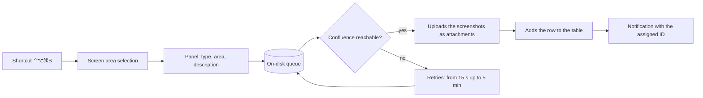

<a id="readme-top"></a>

<div align="center">
  

  <h1>Snitch</h1>

  <p><strong>English</strong> · <a href="README.it.md">Italiano</a></p>

  <p>
    <strong>From the bug on your screen to the row on Confluence, with one shortcut.</strong><br>
    A macOS menu bar app that captures a screenshot, asks for a short description
    and adds the report to the bug table on your Confluence page.
  </p>

  <p>
    
    
    
    
    
  </p>

  <p>
    <a href="https://github.com/p1e7r0/snitch/releases/latest"><strong>Download the app</strong></a>
    ·
    <a href="#getting-started">Getting started</a>
    ·
    <a href="#usage">Usage</a>
    ·
    <a href="#the-confluence-page">The Confluence page</a>
    ·
    <a href="#troubleshooting">Troubleshooting</a>
  </p>
</div>

<details>
  <summary>Table of contents</summary>
  <ol>
    <li><a href="#the-project">The project</a></li>
    <li><a href="#how-it-works">How it works</a></li>
    <li>
      <a href="#getting-started">Getting started</a>
      <ul>
        <li><a href="#prerequisites">Prerequisites</a></li>
        <li><a href="#installation">Installation</a></li>
        <li><a href="#configuration">Configuration</a></li>
      </ul>
    </li>
    <li><a href="#usage">Usage</a></li>
    <li><a href="#the-confluence-page">The Confluence page</a></li>
    <li><a href="#queue-and-retries">Queue and retries</a></li>
    <li><a href="#data-and-security">Data and security</a></li>
    <li><a href="#development">Development</a></li>
    <li><a href="#uninstalling">Uninstalling</a></li>
    <li><a href="#troubleshooting">Troubleshooting</a></li>
    <li><a href="#license">License</a></li>
  </ol>
</details>

## The project

Reporting a bug while you are busy with something else costs too much: take the screenshot, open Confluence, enter edit mode, upload the image, find the next ID, save. Snitch reduces all of that to a shortcut and a line of text, and takes care of the rest in the background.

- **A global shortcut** (`⌃⌥⌘B`, customizable) starts the selection of the screen area to capture.
- **A minimal panel** asks for type (Bug or Feature), area and description; `Return` submits, `Esc` cancels.
- **Several screenshots per report**: press the shortcut again while the panel is open.
- **Several destination pages**, even on different Confluence instances, each with its own token.
- **Automatic sequential ID** and initial status “Open” in every new row.
- **On-disk queue**: if the network or the VPN is down, the report waits and goes out by itself as soon as possible.
- **No duplicate rows**, even if the submission is interrupted halfway and repeated.
- **Ready-made page from a template**: Snitch can create the page with the empty table for you.
- **English and Italian**: the app follows the language of macOS, or the one you choose in the settings, and writes on each page in the language of its table.
- **No external dependencies**: only Swift, AppKit and SwiftUI.

<p align="right">(<a href="#readme-top">back to top</a>)</p>

## How it works



The code is split into two modules:

| Module | Contents |
| --- | --- |
| `SnitchCore` | Logic without a user interface: Confluence REST client, reading and editing the table in the page's storage format, on-disk queue, submission with conflict handling. This is the part covered by tests. |
| `Snitch` | The app: menu bar icon, global shortcut, screen capture, report panel, settings, Keychain, notifications. |

<p align="right">(<a href="#readme-top">back to top</a>)</p>

## Getting started

### Prerequisites

- macOS 15 or later.
- For the prebuilt app: a Mac with Apple Silicon.
- To build from source: Swift toolchain 6.2 or later (included in Xcode 26).
- A Confluence instance reachable over HTTPS and a **personal access token**: Snitch authenticates with the `Authorization: Bearer` header, that is, with Confluence Data Center personal access tokens.
- Permission to edit the page that will hold the reports.

### Installation

#### Download the app

1. Download `Snitch-1.0.dmg` from the [releases page](https://github.com/p1e7r0/snitch/releases/latest).
2. Open the disk image and drag Snitch to the Applications folder.
3. Launch Snitch. On first launch macOS blocks it, because the app is not notarized by Apple: open System Settings → Privacy & Security, scroll down to the warning about Snitch and choose **Open Anyway**.

> [!NOTE]
> The distributed app is ad-hoc signed, without a developer identity. After an update, macOS therefore asks for the screen recording permission again.

#### Build from source

```sh
git clone https://github.com/p1e7r0/snitch.git
cd snitch
./Scripts/build-app.sh --install
```

The script builds in release mode, creates `build/Snitch.app`, signs it and, with `--install`, copies it to `/Applications` and launches it. Without `--install` it stops at the bundle in `build/`.

> [!NOTE]
> The script signs the app ad hoc, without a developer identity: the app works, but macOS will ask for the screen recording permission again after every rebuild. To use your own signing identity, and keep the permissions from one build to the next, set it in `SNITCH_SIGNING_IDENTITY`.

To get a disk image to distribute:

```sh
./Scripts/make-dmg.sh
```

The result is `build/Snitch-<version>.dmg`, with the app and the link to Applications.

### Configuration

On first launch, as long as there is no page with its token, Snitch opens the settings window by itself.

1. **Add a page.** Paste the page address as it appears in the browser. Two formats are recognized, `https` only:
   ```text
   https://confluence.example.com/pages/viewpage.action?pageId=123456
   https://confluence.example.com/spaces/KEY/pages/123456/Title
   ```
   Alternatively use **New page from template**: enter the title and the parent page, and Snitch creates the page with the empty table and adds it to the list.
2. **Save the token.** A dedicated field appears for each host; the token ends up in the macOS Keychain.
3. **Verify.** The “Verify” button confirms the connection and shows how many rows and which areas the table contains.
4. **Grant the screen recording permission.** macOS asks for it on the first capture; after enabling it in System Settings → Privacy & Security → Screen & System Audio Recording, restart Snitch.

In the settings you can also change the shortcut (it needs at least one of `⌘`, `⌃` and `⌥`) and the launch at login, which Snitch enables by itself on first launch if it is located in an Applications folder.

Snitch is available in English and Italian. With **System language** it uses the first of your preferred macOS languages that it supports, and falls back to English. To choose one yourself, use the **Language** menu in the settings: the change takes effect when Snitch restarts, and **Restart now** does it for you.

<p align="right">(<a href="#readme-top">back to top</a>)</p>

## Usage

1. Press `⌃⌥⌘B`, or choose **New report** from the ladybug menu in the menu bar.
2. Drag to select the screen area to capture. `Esc` cancels.
3. In the panel choose **Type** (Bug or Feature) and **Area**, then write the **Description**. The list of areas comes from the table on the page; you can also type a new one.
4. To add more screenshots press the shortcut again or **Add screenshot**.
5. Press `Return`. The panel closes immediately and the submission continues in the background.
6. Once the row is inserted, a notification arrives with the ID, for example “Bug 42 added”. Clicking the notification opens the page.

If you have configured several pages, the panel also shows the **Page** menu; Snitch remembers the last page used and the last area of each one.

The menu bar menu also shows:

- the number of queued reports, next to the icon;
- for each queued report, the reason why it has not gone out yet and the command to delete it;
- **Retry now**, to avoid waiting for the next attempt;
- the direct link to each report page.

<p align="right">(<a href="#readme-top">back to top</a>)</p>

## The Confluence page

Snitch looks in the page for the first table whose header row contains these columns. The titles can be all in English or all in Italian; they are compared case-insensitively, the order is free and any extra columns are left empty.

| Column | Italian title | Required | What Snitch writes |
| --- | --- | :---: | --- |
| ID | ID | yes | The highest ID in the table, plus one |
| Status | Stato | yes | The “Open” status macro, in red |
| Type | Tipo | yes | “Bug” or “Feature” |
| Area | Area | yes | The area chosen in the panel |
| Description | Descrizione | yes | The text of the report |
| Images | Immagini | yes | The screenshots as 150 px thumbnails, enlargeable with a click |
| History | Storia | no | Nothing: it stays available to whoever works on the report |

The new row goes at the bottom of the table, or in the first of the trailing empty rows, if there are any. The change is saved as a minor edit, with a version comment such as `Snitch: Bug 42 in “Area”`.

The language of a page is the language of its column titles, whatever the language of the app: in a table with the Italian titles Snitch writes the status «Aperto» and the version comment `Snitch: Bug 42 in «Area»`. Pages created with earlier, Italian-only versions of Snitch keep working unchanged.

The page created from the template contains the same table, empty, preceded by an info panel with the status legend: “Open”, “In progress” and “Resolved”. It is written in the language the app is running in.

<p align="right">(<a href="#readme-top">back to top</a>)</p>

## Queue and retries

Every report is first written to disk, in `~/Library/Application Support/Snitch/Queue`, and only then sent. Quitting the app or losing the connection does not lose anything.

- **Automatic retries.** The first after 15 seconds, then at doubling intervals up to a maximum of 5 minutes. Snitch also retries immediately when the network comes back, when the Mac wakes up and when you save a token.
- **Repeatable submission.** Attachments are named `snitch-<identifier>-<number>.png`. If the page already references them, the report is considered delivered; if an attachment already exists, it is not uploaded again. A submission interrupted halfway therefore does not produce duplicate rows.
- **Concurrent edits.** If someone saves the page in the meantime, Snitch reads it again and reapplies the row, up to five times per attempt.
- **One host at a time.** If a Confluence instance is unreachable or its token is not valid, the reports for the other hosts go out anyway.

<p align="right">(<a href="#readme-top">back to top</a>)</p>

## Data and security

- Tokens are stored only in the macOS Keychain, one per host, under the service `local.snitch.confluence`.
- The queue folder is readable only by your user and is excluded from backups.
- Requests to Confluence use a session without cookies and without cache, and do not follow redirects.
- Only `https` addresses are accepted.
- Abandoned drafts, that is, screenshots captured without submitting the report, are deleted at the next launch.

<p align="right">(<a href="#readme-top">back to top</a>)</p>

## Development

```sh
swift build
swift test
```

The tests, written with Swift Testing, cover `SnitchCore`: table parsing and editing, REST client and submission flow.

The strings in the code are in English and double as translation keys; the Italian text is in `Resources/it.lproj/Localizable.strings`, which `build-app.sh` copies into the app bundle. An app started with `swift run`, outside the bundle, is always in English.

```text
snitch/
├── Package.swift
├── Resources/            Info.plist, app icon, source image and Italian translation
├── Scripts/
│   ├── build-app.sh      builds, signs and, with --install, installs the app
│   ├── make-dmg.sh       creates the disk image
│   ├── make-icon.sh      regenerates AppIcon.icns from the source image
│   └── uninstall-app.sh  removes app, data, tokens and permissions
├── Sources/
│   ├── Snitch/           the menu bar app
│   └── SnitchCore/       Confluence and queue logic
└── Tests/
    └── SnitchCoreTests/
```

To change the icon replace `Resources/AppIcon-source.png`, or pass another image as an argument, and run:

```sh
./Scripts/make-icon.sh
```

<p align="right">(<a href="#readme-top">back to top</a>)</p>

## Uninstalling

```sh
./Scripts/uninstall-app.sh
```

The script quits Snitch and removes the app from `/Applications`, the queue with its screenshots, the tokens from the Keychain, the preferences and the screen recording permission. If there are reports not yet sent it asks for confirmation; `--force` skips it.

<p align="right">(<a href="#readme-top">back to top</a>)</p>

## Troubleshooting

The reason why a report is stuck can be read in the menu bar menu, in the submenu of the report itself.

| Message | What to do |
| --- | --- |
| Confluence is unreachable (no network or VPN) | Nothing: Snitch retries by itself when the connection comes back |
| The access token for *host* is missing | Save the token for that host in the settings |
| Invalid or expired token | Create a new personal access token and save it in the settings |
| You do not have permission to edit the page | Ask for edit permission on the page or on the space |
| Page not found, or you do not have permission to view it | Check the page address in the settings |
| The page has no table with the columns… | Add the required columns to the table, or create a page from the template |
| The page keeps being edited by others | Nothing: Snitch retries at the next attempt |

If the shortcut does not open the screen selection, check that Snitch is enabled in System Settings → Privacy & Security → Screen & System Audio Recording, and restart it.

<p align="right">(<a href="#readme-top">back to top</a>)</p>

## License

The repository does not contain a license file yet.

<p align="right">(<a href="#readme-top">back to top</a>)</p>
